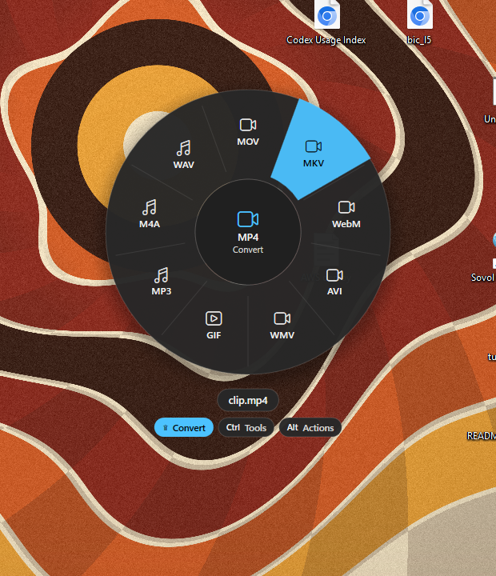

<p align="center">
  
</p>

<h1 align="center">Satsuma</h1>

<p align="center">
  <b>Drag a file. Tap a key. Drop it on a format.</b><br>
  A native-feeling file converter wheel for Windows 10 &amp; 11. Everything runs locally, so your files never leave your PC.
</p>

<p align="center">
  <a href="https://github.com/Dolcruz/satsuma/releases/latest"><b>⬇ Download for Windows</b></a>
</p>

<p align="center">
  
</p>

---

## How it works

1. **Drag any file** from Explorer, the desktop, your browser or anywhere else.
2. **While you drag, tap a key:**
   - <kbd>Shift</kbd> opens the **Convert** wheel (HEIC → JPG, MOV → MP4, PDF → PNG …)
   - <kbd>Ctrl</kbd> opens the **Tools** wheel (compress, resize, rotate, merge PDFs, mute video …)
   - <kbd>Alt</kbd> opens the **Actions** wheel (share, float, copy/move to, copy path, Terminal)
   
   Tap another key to switch wheels.
3. **Drop the file on a slice.** The result appears next to the original. Nothing is overwritten, and the original stays where it is.

Satsuma only shows the wheel when you *tap* a key (press and release quickly). Holding <kbd>Ctrl</kbd> to copy files in Explorer works exactly as before.

### Without dragging

- **Keyboard:** select files in Explorer and press <kbd>Ctrl</kbd> + <kbd>Shift</kbd> + <kbd>Space</kbd>. Use the arrow keys or <kbd>1</kbd>–<kbd>9</kbd> to choose, <kbd>Enter</kbd> to apply and <kbd>Esc</kbd> to cancel.
- **Right-click** a file → *Show more options* → **Convert with Satsuma**.

## What it can do

| | Convert to | Tools |
|---|---|---|
| **Images**: JPG, PNG, WebP, HEIC, AVIF, TIFF, BMP, GIF, ICO, SVG, PSD | JPG · PNG · WebP · AVIF · TIFF · BMP · GIF · ICO · PDF | Compress · Resize 50 % · Rotate · Flip · Grayscale · Strip EXIF · *Make PDF* · *Make GIF* |
| **Video**: MP4, MOV, MKV, WebM, AVI, WMV, M4V … | MP4 · MOV · MKV · WebM · AVI · WMV · GIF · MP3 · M4A · WAV | Compress · 720p · Mute · Rotate · 2× Speed · Snapshot |
| **Audio**: MP3, M4A, WAV, FLAC, OGG, Opus, AIFF, WMA | MP3 · M4A · WAV · FLAC · OGG · Opus · AIFF · WMA | Compress · Normalize · Mono · Trim Silence |
| **PDF** | PNG · JPG (every page) · TXT · MD · DOCX · HTML | Split · Rotate · *Merge* |
| **Documents**: DOCX, RTF, Markdown, TXT, HTML | DOCX · MD · TXT · HTML | |
| **Spreadsheets**: XLSX, CSV, TSV | XLSX · CSV · TSV · JSON · HTML | |
| **Subtitles**: SRT, VTT | SRT · VTT · TXT | |
| **Archives**: ZIP, TAR, TGZ, 7z, RAR | ZIP · TAR · TGZ | Extract |
| **Anything, including folders** | | ZIP |

*Italic* tools appear when several files are selected. Mixed selections only show what works for every file.

**Actions** work on any file or folder:

- **Share**: the Windows share sheet (Nearby Sharing, Mail, Teams …).
- **Float**: pins the file as a small always-on-top card. Drag it into any app later.
- **Copy to / Move to**: uses the native Windows copy engine, with its progress and conflict dialogs.
- **Copy Path**
- **Terminal**: opens Windows Terminal in that folder.

## Install

1. Download **`Satsuma-Setup-x.y.z.exe`** from [Releases](https://github.com/Dolcruz/satsuma/releases/latest).
2. Run it. It doesn't need admin rights and installs for your user only.
3. Satsuma starts in the system tray and launches with Windows (you can change this in Settings).

> **SmartScreen warning?** The installer isn't code-signed yet, so Windows may show *"Windows protected your PC"*. Click **More info → Run anyway**. The whole source is in this repo, and you can build it yourself (see below).

A **portable ZIP** is also available. Unzip it anywhere and run `Satsuma.exe`.

**Video & audio** use [FFmpeg](https://ffmpeg.org). If it isn't already on your PC, Satsuma downloads the official essentials build once (~100 MB, from gyan.dev) the first time you convert a video or audio file. You can also download it from Settings.

**Uninstall:** go to *Settings → Apps → Satsuma → Uninstall*. This also removes the autostart and context-menu entries.

## Footprint

Measured on Windows 11 with a 24-thread CPU:

| | CPU | RAM (working set) |
|---|---|---|
| Idle in tray, global hooks active | ~0.05 % | ~12 MB |
| While the wheel is open | ~1 % | ~120 MB, released a few seconds after closing |

The Fluent UI library only loads when you open Settings or the tray menu. After every wheel or conversion, Satsuma compacts its heap and hands memory back to Windows.

## Privacy

- No uploads, no accounts, no telemetry.
- The only network request is the optional one-time FFmpeg download.
- Settings live in `%APPDATA%\Satsuma\settings.json`.

## Build from source

Requires the [.NET 10 SDK](https://dotnet.microsoft.com/download) on Windows.

```bash
git clone https://github.com/Dolcruz/satsuma.git
cd satsuma
dotnet run --project src/Satsuma
```

To build a release (self-contained publish, portable ZIP and installer), you need [Inno Setup 6](https://jrsoftware.org/isinfo.php):

```bash
pwsh build/build.ps1 -Version 1.0.0
```

Self-test: this generates sample files of every kind and runs every wheel slice on them.

```bash
dotnet run --project src/Satsuma -- --selftest %TEMP%\satsuma-test
```

### How the gesture works

A low-level mouse and keyboard hook *observes* input without ever blocking it. When a drag is in progress and a modifier is tapped, Satsuma shows an invisible, layered, topmost window under the cursor. That window registers as an OLE drop target. Once Windows reports files being dragged over it, the wheel fades in. The drop lands on the slice under the cursor and is always accepted as a *copy*, so the source app never deletes the original.

## Credits

Inspired by [Tangerine for Mac](https://tangerineformac.com). Satsuma is an independent project and isn't affiliated with it.

Built with [WPF-UI](https://github.com/lepoco/wpfui), [Magick.NET](https://github.com/dlemstra/Magick.NET), [PDFsharp](https://www.pdfsharp.com), [PdfPig](https://github.com/UglyToad/PdfPig), [ClosedXML](https://github.com/ClosedXML/ClosedXML), [Markdig](https://github.com/xoofx/markdig) and [FFmpeg](https://ffmpeg.org) (downloaded separately, not bundled).

## License

[MIT](LICENSE)
